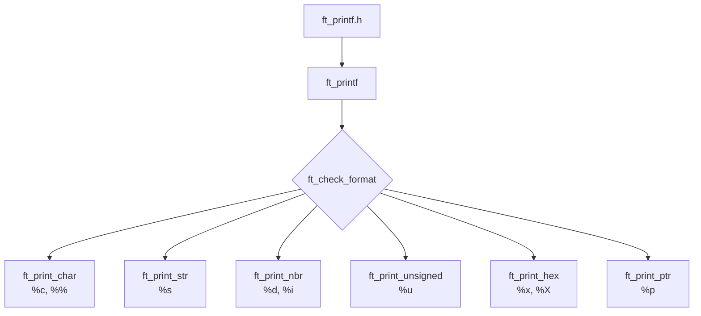

*Este proyecto ha sido creado como parte del currículo de 42 por joquinta.*

---

# ft_printf

## Índice

- [Descripción](#descripción)
- [Concepto Clave: Funciones Variádicas (`<stdarg.h>`)](#concepto-clave-funciones-variádicas-stdargh)
- [Arquitectura del proyecto](#arquitectura-del-proyecto)
- [Diagrama de flujo](#diagrama-de-flujo)
- [Casos Límite (Edge Cases) y Pruebas](#casos-límite-edge-cases-y-pruebas)
- [Algoritmo y Estructura de Datos](#algoritmo-y-estructura-de-datos)
- [Instrucciones](#instrucciones)
- [Depuración, Leaks y Testers](#depuración-leaks-y-testers)
- [Recursos](#recursos)

## Descripción

El proyecto **ft_printf** consiste en la reimplementación de la famosa función `printf()` de la librería estándar de C (`libc`). 

El objetivo principal es comprender y manejar las **funciones variádicas** en C (aquellas que aceptan un número indeterminado de argumentos utilizando la librería `<stdarg.h>`), así como afianzar la gestión de formatos de conversión, punteros y bases numéricas (decimal y hexadecimal).

### Conversiones Soportadas:
- `%c`: Imprime un solo carácter.
- `%s`: Imprime una cadena de caracteres.
- `%p`: Imprime el puntero `void *` dado como argumento en formato hexadecimal.
- `%d` / `%i`: Imprime un número entero con signo en base 10.
- `%u`: Imprime un número decimal sin signo en base 10.
- `%x`: Imprime un número hexadecimal en base 16 en minúsculas.
- `%X`: Imprime un número hexadecimal en base 16 en mayúsculas.
- `%%`: Imprime un símbolo de porcentaje.

---

##  Concepto Clave: Funciones Variádicas (`<stdarg.h>`)

A diferencia de las funciones convencionales en C que requieren un número fijo de argumentos, una **función variádica** permite recibir un número variable de parámetros gracias al uso de puntos suspensivos (`...`) en su prototipo:

```
int ft_printf(const char *format, ...);
```

Para procesar estos argumentos desconocidos en tiempo de compilación, la librería `<stdarg.h>` nos proporciona las siguientes herramientas y macros:

1. **`va_list`**: Tipo de dato que funciona como un puntero/contenedor que apunta a la lista de argumentos variables.
2. **`va_start(args, format)`**: Inicializa la lista `args`. Requiere como parámetro el último argumento fijo de la función (`format`) para saber dónde empieza la secuencia de argumentos variables.
3. **`va_arg(args, tipo)`**: Extrae el siguiente argumento de la lista convirtiéndolo al `tipo` especificado y avanza automáticamente al siguiente argumento. 
*(Nota: Los tipos pequeños como `char` o `short` se promocionan automáticamente a `int` al pasarse por argumentos variádicos)*.
4. **`va_end(args)`**: Finaliza la lectura y realiza las tareas de limpieza del estado de la lista antes de salir de la función.

---

## Arquitectura del proyecto

La estructura de ft_printf cuenta con los siguientes archivos principales:

<details>
<summary><b>Makefile</b> — Encargado de compilar tu librería libftprintf.a.</summary>

``` 
NAME		= libftprintf.a

CC			= cc
CFLAGS		= -Wall -Wextra -Werror
AR			= ar rcs
RM			= rm -f

SRCS		= ft_printf.c \
			  ft_check_format.c \
			  ft_print_char.c \
			  ft_print_str.c \
			  ft_print_nbr.c \
			  ft_print_unsigned.c \
			  ft_print_hex.c \
			  ft_print_ptr.c

OBJS		= $(SRCS:.c=.o)

# ------------------------------------------------------------------------------
# REGLAS PRINCIPALES
# ------------------------------------------------------------------------------

all: $(NAME)

$(NAME): $(OBJS)
	$(AR) $(NAME) $(OBJS)

%.o: %.c ft_printf.h
	$(CC) $(CFLAGS) -c $< -o $@

clean:
	$(RM) $(OBJS)

fclean: clean
	$(RM) $(NAME)

re: fclean all

.PHONY: all clean fclean re
```

</details>

<details>
<summary><b>ft_printf.h</b> — El archivo de cabecera con los prototipos de las funciones, las librerías necesarias (<stdarg.h>, <unistd.h>) y la inclusión de libft (si se utiliza).</summary>

``` C
#ifndef FT_PRINTF_H
# define FT_PRINTF_H

# include <stdarg.h>
# include <unistd.h>
# include <limits.h>
# include <stdint.h>

/* PRINCIPAL FUNTION*/
int	ft_printf(char const *format, ...);

/* AUX FUNTIONS*/
int	ft_check_format(char sp, va_list args);
int	ft_print_char(char c);
int	ft_print_str(char *str);
int	ft_print_nbr(int n);
int	ft_print_unsigned(unsigned int n);
int	ft_print_hex(unsigned int n, char sp);
int	ft_print_ptr(unsigned long ptr);

#endif
```

</details> 

<details>
<summary><b>ft_printf.c</b> - La función principal que recorre la cadena format y gestiona las funciones variádicas (va_start, va_arg, va_end).</summary>

```C
int	ft_printf(char const *format, ...)
{
	va_list	args;
	int		count;
	int		i;

	if (!format)
		return (-1);
	count = 0;
	va_start(args, format);
	i = 0;
	while (format[i])
	{
		if (format[i] == '%' && format[i + 1] != '\0')
		{
			i++;
			count = count + ft_check_format(format[i], args);
		}
		else if (format[i] != '%')
		{
			write(1, &format[i], 1);
			count++;
		}
		i++;
	}
	va_end(args);
	return (count);
}
```

</details>

<details>
<summary><b>ft_check_format.c</b> — La función distribuidora, se encarga de reconocer cada caracter especificador y llamar a las funciones "print" correspondientes.</summary>

``` C
int	ft_check_format(char sp, va_list args)
{
	int	count;

	count = 0;
	if (sp == 'c')
		count = count + ft_print_char(va_arg(args, int));
	else if (sp == 's')
		count = count + ft_print_str(va_arg(args, char *));
	else if (sp == 'd' || sp == 'i')
		count = count + ft_print_nbr(va_arg(args, int));
	else if (sp == 'u')
		count = count + ft_print_unsigned(va_arg(args, unsigned int));
	else if (sp == 'x' || sp == 'X')
		count = count + ft_print_hex(va_arg(args, unsigned int), sp);
	else if (sp == 'p')
		count = count + ft_print_ptr((unsigned long) va_arg(args, void *));
	else if (sp == '%')
		count = count + ft_print_char('%');
	return (count);
}
```

</details>  

### Módulos de impresión auxiliaries: Funciones encargadas de procesar cada tipo de conversión especifico (%c, %s, %p, %d/%i, %u, %x/%X).

<details>
<summary><b>ft_print_char.c</b> — Procesa un único carácter (%c) o el escape %%.</summary>

``` C
int ft_print_char(char c)
{
    write(1, &c, 1);
    return (1);
}
```

</details>

<details>
<summary><b>ft_print_str.c</b> — Imprime cadenas completas (%s) y gestiona casos especiales como punteros a NULL.</summary>

``` C
int	ft_print_str(char *str)
{
	int	i;

	if (!str)
		str = "(null)";
	i = 0;
	while (str[i])
	{
		write(1, &str[i], 1);
		i++;
	}
	return (i);
}
```
</details>

<details>
<summary><b>ft_print_nbr.c</b> — Gestiona la conversión e impresión de números enteros con signo (%d, %i).</summary>

``` C
int	ft_print_nbr(int n)
{
	int	count;

	count = 0;
	if (n == INT_MIN)
		return (ft_print_str("-2147483648"));
	if (n < 0)
	{
		count = count + (ft_print_char('-'));
		n = -n;
	}
	if (n >= 10)
		count = count + (ft_print_nbr(n / 10));
	count = count + ft_print_char((n % 10) + '0');
	return (count);
}
```

</details>

  <details>
<summary><b>ft_print_unsigned.c</b> — Gestiona la conversión e impresión de números enteros sin signo (%u).</summary>

``` C
int	ft_print_unsigned(unsigned int n)
{
	int	count;

	count = 0;
	if (n >= 10)
		count = count + ft_print_unsigned(n / 10);
	count = count + ft_print_char((n % 10) + '0');
	return (count);
}
```

</details> 

<details>
<summary><b>ft_print_hex.c</b> — Maneja las conversiones a hexadecimal en minúsculas y mayúsculas (%x, %X).</summary>

``` C
int	ft_print_hex(unsigned int n, char sp)
{
	int	count;
	int	rest;

	count = 0;
	rest = 0;
	if (n >= 16)
		count = count + ft_print_hex(n / 16, sp);
	if ((n % 16) < 10)
		count = count + ft_print_char((n % 16) + '0');
	else
	{
		if (sp == 'x')
			count = count + ft_print_char((n % 16 - 10) + 'a');
		else if (sp == 'X')
			count = count + ft_print_char((n % 16 - 10) + 'A');
	}
	return (count);
}
```

</details>

<details>
<summary><b>ft_print_ptr.c</b> — Maneja la impresión de direcciones de memoria de punteros (%p) agregando el prefijo 0x.</summary>

``` C
int	ft_print_ptr(unsigned long ptr)
{
	int	count;

	if (!ptr)
		return (ft_print_str("(nil)"));
	count = 0;
	if (ptr >= 16)
		count = count + ft_print_ptr(ptr / 16);
	else
		count = count + ft_print_str("0x");
	if ((ptr % 16) < 10)
		count = count + ft_print_char((ptr % 16) + '0');
	else
		count = count + ft_print_char((ptr % 16 - 10) + 'a');
	return (count);
}
```

</details>
  
## Diagrama de flujo   


## Casos Límite (Edge Cases) y Pruebas

Para garantizar que la función se comporte de manera idéntica a la `libc` original y no falle durante las evaluaciones entre pares, se han tenido en cuenta los siguientes casos especiales según el tipo de conversión:

### Casos Críticos por Conversión:
- **`%s` (Cadenas de caracteres):**
  - **Puntero `NULL`:** Si la cadena pasada es un puntero nulo, se imprime `(null)` sin provocar un fallo de segmentación (*Segmentation Fault*).
- **`%p` (Direcciones de memoria / Punteros):**
  - **Puntero `NULL`:** La dirección recibida es `0x0`. En entornos Linux se imprime `(nil)` y en macOS `0x0` o `0x00`, adaptándose a la `libc` correspondiente.
  - **Prefijo:** Añade correctamente el prefijo `0x` antes de imprimir la dirección en formato hexadecimal minúscula.
- **`%d` / `%i` (Enteros con signo):**
  - **`INT_MIN` (`-2147483648`):** Evita desbordamiento al intentar negativar o positivar el valor directamente, asegurando que se procesen los 10 dígitos correctamente.
  - **`0`:** Imprime correctamente el carácter `'0'` sin entrar en bucles infinitos o omitir la salida.
- **`%u` (Enteros sin signo):**
  - **`UINT_MAX` (`4294967295`):** Manejo correcto del valor máximo de 32 bits sin signo.
- **`%x` / `%X` (Hexadecimales):**
  - **`0`:** Debe imprimir un único `'0'` (no `00` ni una cadena vacía).

### Robusteza e Integridad del Retorno:
- **Conteo Acumulado (`int count`):** Cada función auxiliar devuelve la cantidad exacta de caracteres impresos. Si ocurre un fallo en la llamada al sistema `write`, se detiene la acumulación y se propaga la cuenta correcta de bytes.
---

## Algoritmo y Estructura de Datos

### Estructura de Datos

No se utilizaron estructuras de datos complejas (como listas enlazadas o árboles) ni buffers dinámicos dinámicamente asignados, conforme a las restricciones del subject que prohíben la gestión de buffer del printf original.   
Se utiliza un enfoque iterativo directo apoyado en un contador acumulativo (int count) que rastrea la cantidad exacta de bytes/caracteres escritos mediante la llamada al sistema 

### Algoritmo de Procesamiento

1. Recorrido del formato: 
    Se itera caracter por caracter sobre el string format recibido.   

2. Detección de especificador:
    - Si se encuentra un caracter común, se escribe directamente en STDOUT (write(1, ...)) e incrementa el contador.
    - Si se detecta un %, se consulta el siguiente carácter para identificar la conversión solicitada (c, s, p, d, i, u, x, X, %).
3. Despacho y Conversión: Se extrae el siguiente argumento utilizando va_arg y se deriva a la función auxiliar correspondiente:   
    - Bases numéricas / Hexadecimal (%x, %X, %p): Se aplica un algoritmo recursivo de división e impresión mediante módulo (base 10 y base 16).
    - Manejo de Casos Nulos: Se comprueban punteros NULL (imprimiendo (null) para %s o (nil)/0x0 para %p según el estándar de la libc)
4. Retorno: Retorna el valor acumulado del número total de caracteres impresos en pantalla.

---

##  Instrucciones

### Requisitos Previos e Instalación

Para compilar y probar este proyecto necesitarás un entorno Unix con `gcc` o `clang` y `make`.

### Compilación

Clona el repositorio e ingresa a la carpeta del proyecto:

```
git clone <url-del-repositorio>
cd ft_printf
```

Para generar la librería estática libftprintf.a, ejecuta:
```
make
```
Reglas Disponibles del Makefile
- make
	- make all: Compila el proyecto y genera la librería libftprintf.a.
	- make clean: Elimina los archivos objeto (.o).   
	- make fclean: Elimina los archivos objeto y la librería libftprintf.a.   
	- make re: Ejecuta fclean y vuelve a compilar todo (all).   

Compila enlazando con la librería creada:

En Terminal:
```
gcc -Wall -Wextra -Werror main.c libftprintf.a -o test_printf
./test_printf
```
## Depuración, Leaks y Testers

### Compilación con Flags de Depuración y AddressSanitizer

Para detectar accesos indebidos a memoria, lecturas fuera de rango o variables no inicializadas durante el desarrollo, se puede compilar un archivo de prueba enlazando la librería con símbolos de depuración (`-g3`) y el analizador `-fsanitize=address`:

```bash
# Compilar ejecutable con AddressSanitizer (ASan)
gcc -Wall -Wextra -Werror -g3 -fsanitize=address main.c libftprintf.a -o test_asan

# Ejecutar binario de depuración
./test_asan
```

### Detección de Fugas de Memoria con Valgrind

Para comprobar la integridad de la memoria y asegurar que no existen fugas (memory leaks) al procesar punteros o cadenas:

```Bash
# Compilar ejecutable de prueba con símbolos de depuración
gcc -Wall -Wextra -Werror -g main.c libftprintf.a -o test_valgrind

# Ejecutar análisis completo de memoria
valgrind --leak-check=full --show-leak-kinds=all --track-origins=yes ./test_valgrind
```

### Pruebas Automatizadas con printf_tester

Para validar el comportamiento de la librería frente a la función original de la `libc`, se utiliza el suite de pruebas [printf_tester]

```Bash
# Clonar el repositorio del tester dentro de la raíz del proyecto
git clone https://github.com/Sfabi28/printf_tester.git

# Acceder al directorio del tester
cd printf_tester

# Ejecutar la batería completa de pruebas
make
```
### Main de Prueba Personalizado

Para realizar una verificación rápida y comparar la salida y los valores de retorno de `ft_printf` contra el `printf` original de la `libc`, se puede utilizar el siguiente archivo `main.c`:

<details>
<summary><b>Ver código fuente de main.c de prueba</b></summary>

```c
#include "ft_printf.h"
#include <stdio.h>
#include <limits.h>

void	test_header(const char *title)
{
	printf("\n========================================\n");
	printf("  %s\n", title);
	printf("========================================\n");
}

int	main(void)
{
	int		res1;
	int		res2;
	void	*ptr;

	ptr = &res1;
	// 1. CARACTERES Y CADENAS (%c, %s, %%)
	test_header("1. PRUEBAS: %c, %s, %%");
	res1 = ft_printf("ft_printf : %c | %s | %%\n", 'A', "Hola 42");
	res2 = printf("   printf : %c | %s | %%\n", 'A', "Hola 42");
	printf("--> Retornos -> ft_printf: %d | printf: %d\n\n", res1, res2);
	char	*null_str;

	null_str = NULL;
	res1 = ft_printf("ft_printf NULL str : %s\n", null_str);
	res2 = printf("   printf NULL str : %s\n", null_str);
	printf("--> Retornos -> ft_printf: %d | printf: %d\n", res1, res2);
	// 2. ENTEROS CON SIGNO (%d, %i)
	test_header("2. PRUEBAS: %d, %i");
	res1 = ft_printf("ft_printf : %d | %i | %d | %i\n", 0, -42, 1337, INT_MAX);
	res2 = printf("   printf : %d | %i | %d | %i\n", 0, -42, 1337, INT_MAX);
	printf("--> Retornos -> ft_printf: %d | printf: %d\n\n", res1, res2);
	res1 = ft_printf("ft_printf INT_MIN : %d\n", INT_MIN);
	res2 = printf("   printf INT_MIN : %d\n", INT_MIN);
	printf("--> Retornos -> ft_printf: %d | printf: %d\n", res1, res2);
	// 3. ENTEROS SIN SIGNO (%u)
	test_header("3. PRUEBAS: %u");
	res1 = ft_printf("ft_printf : %u | %u\n", 0, UINT_MAX);
	res2 = printf("   printf : %u | %u\n", 0, UINT_MAX);
	printf("--> Retornos -> ft_printf: %d | printf: %d\n", res1, res2);
	// 4. HEXADECIMALES (%x, %X)
	test_header("4. PRUEBAS: %x, %X");
	res1 = ft_printf("ft_printf : %x | %X | %x\n", 0, 255, 3735928559U);
	res2 = printf("   printf : %x | %X | %x\n", 0, 255, 3735928559U);
	printf("--> Retornos -> ft_printf: %d | printf: %d\n", res1, res2);
	// 5. PUNTEROS (%p)
	test_header("5. PRUEBAS: %p");
	res1 = ft_printf("ft_printf ptr : %p\n", ptr);
	res2 = printf("   printf ptr : %p\n", ptr);
	printf("--> Retornos -> ft_printf: %d | printf: %d\n\n", res1, res2);
	res1 = ft_printf("ft_printf NULL ptr : %p\n", NULL);
	res2 = printf("   printf NULL ptr : %p\n", NULL);
	printf("--> Retornos -> ft_printf: %d | printf: %d\n", res1, res2);
	return (0);
}
```
</details>

---

## Recursos
### Referencias y Documentación: 
- Manual de C para printf: man 3 printf.
- Documentación oficial de <stdarg.h> y funciones variádicas en C (va_start, va_arg, va_copy, va_end).
- Canal de youtube: Oceano  https://www.youtube.com/@onaecO

### Uso de Inteligencia Artificial
En cumplimiento de las normas de integridad del proyecto y de la sección Recursos del Readme:   
- Tareas donde se usó IA: 
    - Explicación conceptual sobre cómo funcionan las funciones variádicas (stdarg.h), sugerencias para estructurar la arquitectura de archivos del proyecto y revisión inicial de la plantilla del archivo README.md.   
- Partes del proyecto donde se utilizó: 
    - Fase teórica previa y maquetación de la documentación. Todo el código C y la lógica de parseo/impresión han sido analizados, comprendidos e implementados directamente por el estudiante para garantizar un aprendizaje real y preparar la evaluación entre pares y exámenes.

