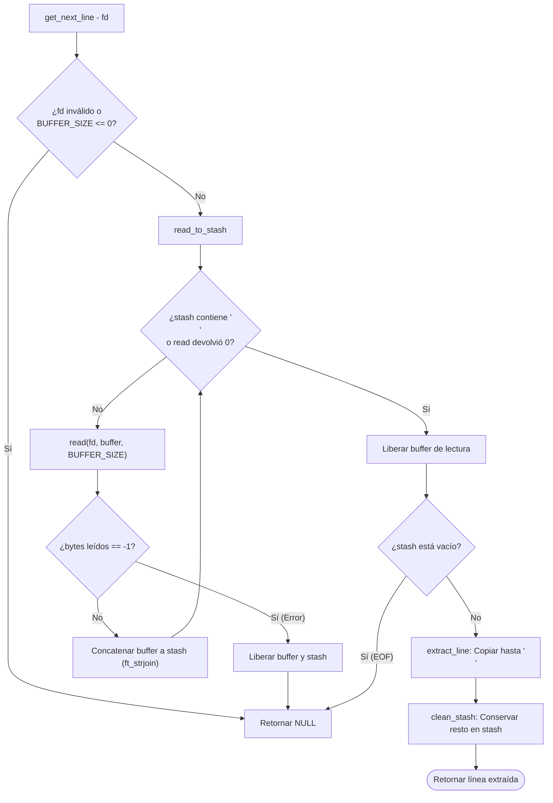

*Este proyecto ha sido creado como parte del currículo de 42 por joquinta.*

# Get Next Line

## Índice

- [Descripción](#descripción)
- [Concepto Clave: Variables Estáticas (`static`)](#concepto-clave-variables-estáticas-static)
- [Arquitectura del proyecto](#arquitectura-del-proyecto)
- [Diagrama de flujo](#diagrama-de-flujo)
- [Casos Límite (Edge Cases) y Pruebas](#casos-límite-edge-cases-y-pruebas)
- [Algoritmo y Estructura de Datos](#algoritmo-y-estructura-de-datos)
- [Instrucciones](#instrucciones)
- [Depuración, Leaks y Testers](#depuración-leaks-y-testers)
- [Recursos](#recursos)

---

## Descripción

El proyecto **Get Next Line** (GNL) consiste en la implementación de una función en C capaz de leer y devolver, línea por línea, el contenido leído desde un descriptor de archivo (*File Descriptor* / `fd`) o desde la entrada estándar (`stdin`).

El objetivo principal es: 
- aprender a manipular la lectura de archivos mediante la llamada al sistema `read()`.
- gestionar la memoria dinámica dinámicamente asignada con `malloc` y `free`.
- dominar el concepto de **variables estáticas** en C para mantener el estado de lectura entre llamadas consecutivas a la función.

### Características Principales:
- **Lectura progresiva:** Devuelve una línea completa terminada en `\n` en cada llamada (salvo si llega al final del archivo y este no termina con un salto de línea).
- **Flexibilidad de lectura:** El tamaño de bloque leído por `read()` es configurable mediante la macro de compilación `-D BUFFER_SIZE=n`.
- **Soporte Multidiscriptor (Bonus):** Capacidad de leer de múltiples descriptores de archivo de forma alterna sin perder la posición de lectura de ninguno de ellos.
- **Cero Fugas de Memoria:** Gestión estricta del *heap* para garantizar que no existan *memory leaks*.

---

## Concepto Clave: Variables Estáticas (`static`)

A diferencia de las variables locales comunes (que residen en la pila o *stack* y se destruyen al salir de la función), una **variable estática** declarada dentro de una función se almacena en el segmento de datos del programa. Esto le otorga dos propiedades fundamentales:

1. **Persistencia:** Mantiene su valor almacenado en memoria a lo largo de toda la ejecución del programa, incluso entre múltiples llamadas a la función.

2. **Alcance local:** Su visibilidad sigue estando limitada exclusivamente al bloque o función donde fue declarada.

```c
char *get_next_line(int fd)
{
    static char *stash; // Mantiene el sobrante de la lectura anterior
    ...
}
```

En **Get Next Line**, la variable estática actúa como un **acumulador o reserva (*stash*)**. 
Dado que `read()` lee en bloques de tamaño dinámico `BUFFER_SIZE` (que puede ser de 1, 42 o 10,000,000 bytes), es muy probable que una sola lectura devuelva más de una línea o deje media línea pendiente. 
La variable estática permite "recordar" ese fragmento leído pero no entregado para utilizarlo en la siguiente llamada.

---

## Arquitectura del proyecto

La estructura de **Get Next Line** cuenta con los siguientes archivos principales:

<details>
<summary><b>get_next_line.h</b> — El archivo de cabecera con los prototipos de las funciones, las librerías necesarias.</summary>

```c
#ifndef GET_NEXT_LINE_H
# define GET_NEXT_LINE_H

# include <unistd.h>
# include <stdlib.h>

# fndef BUFFER_SIZE
#  define BUFFER_SIZE 42
# endif

/* FUNCIÓN PRINCIPAL */
char	*get_next_line(int fd);

/* FUNCIONES AUXILIARES */
size_t	ft_strlen(const char *s);
char	*ft_strchr(const char *s, int c);
char	*ft_strjoin(char *s1, char *s2);
char	*ft_substr(char const *s, unsigned int start, size_t len);

#endif
```
</details>

<details>
<summary><b>get_next_line.c</b> — El archivo principal.</summary>

```c
#include "get_next_line.h"

static char	*read_to_stash(int fd, char *stash)
{
	char	*buffer;
	int		bytes_read;

	buffer = malloc(sizeof(char) * (BUFFER_SIZE + 1));
	if (!buffer)
		return (free(stash), NULL);
	bytes_read = 1;
	while (!ft_strchr(stash, '\n') && bytes_read > 0)
	{
		bytes_read = read(fd, buffer, BUFFER_SIZE);
		if (bytes_read == -1)
			return (free(buffer), free(stash), NULL);
		buffer[bytes_read] = '\0';
		stash = ft_strjoin(stash, buffer);
	}
	free(buffer);
	return (stash);
}
```s
```c
static char	*extract_line(char *stash)
{
	int		i;
	char	*line;

	if (!stash || !*stash)
		return (NULL);
	i = 0;
	while (stash[i] && stash[i] != '\n')
		i++;
	if (stash[i] == '\n')
		line = ft_substr(stash, 0, i + 1);
	else
		line = ft_substr(stash, 0, i);
	return (line);
}
```
```c
static char	*clean_stash(char *stash)
{
	int		i;
	char	*new_stash;

	i = 0;
	while (stash[i] && stash[i] != '\n')
		i++;
	if (!stash[i])
		return (free(stash), NULL);
	new_stash = ft_substr(stash, i + 1, ft_strlen(stash) - i);
	free(stash);
	return (new_stash);
}
```
```c
char	*get_next_line(int fd)
{
	static char	*stash;
	char		*line;

	if (fd < 0 || BUFFER_SIZE <= 0)
		return (NULL);
	stash = read_to_stash(fd, stash);
	if (!stash)
		return (NULL);
	line = extract_line(stash);
	stash = clean_stash(stash);
	return (line);
}
```
</details>

<details>
<summary><b>get_next_line_utils.c</b> — El archivo que contiene las funciones auxiliares.</summary>

```c
#include "get_next_line.h"

size_t	ft_strlen(const char *s)
{
	size_t	i;

	if (!s)
		return (0);
	i = 0;
	while (s[i])
		i++;
	return (i);
}
```
```c
char	*ft_strchr(const char *s, int c)
{
	if (!s)
		return (NULL);
	while (*s)
	{
		if (*s == (char)c)
			return ((char *)s);
		s++;
	}
	if ((char)c == '\0')
		return ((char *)s);
	return (NULL);
}
```
```c
char	*ft_strjoin(char *s1, char *s2)
{
	char	*str;
	size_t	i;
	size_t	j;

	if (!s1)
	{
		s1 = malloc(1 * sizeof(char));
		if (!s1)
			return (NULL);
		s1[0] = '\0';
	}
	if (!s2)
		return (free(s1), NULL);
	str = malloc(sizeof(char) * (ft_strlen(s1) + ft_strlen(s2) + 1));
	if (!str)
		return (free(s1), NULL);
	i = -1;
	while (s1[++i])
		str[i] = s1[i];
	j = -1;
	while (s2[++j])
		str[i + j] = s2[j];
	str[i + j] = '\0';
	free(s1);
	return (str);
}
```
```c
char	*ft_substr(char const *s, unsigned int start, size_t len)
{
	char	*str;
	size_t	i;

	if (!s)
		return (NULL);
	if (start >= ft_strlen(s))
		return (NULL);
	if (len > ft_strlen(s) - start)
		len = ft_strlen(s) - start;
	str = malloc(sizeof(char) * (len + 1));
	if (!str)
		return (NULL);
	i = 0;
	while (i < len && s[start + i])
	{
		str[i] = s[start + i];
		i++;
	}
	str[i] = '\0';
	return (str);
}
```
</details>

<details>
<summary><b>get_next_line_bonus.c</b> — El archivo que contempla la opcion bonus del proyecto.</summary>

```c
#include "get_next_line_bonus.h"

char	*get_next_line(int fd)
{
	static char	*stash[1024]; // Soporte para múltiples FDs usando un arreglo de punteros
	char		*line;

	if (fd < 0 || fd >= 1024 || BUFFER_SIZE <= 0)
		return (NULL);
	stash[fd] = read_to_stash(fd, stash[fd]);
	if (!stash[fd])
		return (NULL);
	line = extract_line(stash[fd]);
	stash[fd] = clean_stash(stash[fd]);
	return (line);
}
```

</details>

---

## Diagrama de flujo



---

## Casos Límite (Edge Cases) y Pruebas

Para asegurar la máxima estabilidad de la función ante cualquier archivo o condición de entrada, se han contemplado y probado los siguientes escenarios críticos:

### Casos Críticos de Lectura:

* **Archivos sin salto de línea final:** Si el archivo termina sin `\n`, la función debe devolver el texto restante en la primera llamada y `NULL` en la llamada posterior.


* **Archivos vacíos / Lector al final (EOF):** La primera llamada debe retornar `NULL` inmediatamente sin provocar fallos de segmentación o desbordamientos de memoria.


* **Variaciones extremas de `BUFFER_SIZE`:**

	* `BUFFER_SIZE = 1`: Lee el archivo carácter por carácter. Requiere muchas concatenaciones, evaluando la robustez de la liberación de memoria.


	* `BUFFER_SIZE = 9999999`: Lee bloques masivos de una sola vez. Verifica que no haya desbordamiento de búfer (*buffer overflow*).


* **Descriptores de archivo inválidos:** Retorna `NULL` de inmediato si se pasa un `fd` negativo (ej. `-1`), un descriptor cerrado o un `fd` fuera de rango.


* **Entrada Estándar (`stdin`):** La función debe interactuar correctamente cuando recibe lecturas por teclado o tuberías (*pipes*).


### Gestión de Errores y Memoria:

* **Fallo de `read()` a mitad de lectura:** Si `read()` devuelve `-1` (por ejemplo, si se remueve el archivo durante la ejecución), la función debe liberar el buffer temporal, liberar la variable estática acumulada y retornar `NULL`.


* **Ausencia de Memory Leaks:** Cada bloque asignado dinámicamente con `malloc` para lecturas intermedias o uniones de cadenas es sistemáticamente liberado cuando ya no es necesario o cuando ocurre un error de ejecución.

---

## Algoritmo y Estructura de Datos

### Estructura de Datos

El proyecto no requiere de estructuras complejas (como listas enlazadas), sino el uso eficiente de **cadenas de caracteres asignadas dinámicamente (`char *`)** gestionadas mediante una **variable estática**.

En la parte bonus, se utiliza un **arreglo de punteros estáticos** (`static char *stash[1024]`), donde el índice del arreglo corresponde directamente al número entero del descriptor de archivo (`fd`), aislando por completo la memoria de cada archivo abierto.

### Algoritmo de Procesamientos

El ciclo de vida de una llamada a `get_next_line()` consta de 4 fases secuenciales:

1. **Fase de Validación:** Comprobación rápida de parámetros (`fd >= 0`, `BUFFER_SIZE > 0`).

2. **Fase de Acumulación (`read_to_stash`):**
	* Se lee del archivo en bloques de `BUFFER_SIZE` usando la función `read()`.
	* Cada bloque se une al `stash` estático mediante concatenación dinámicamente liberada (`ft_strjoin`).
	* El bucle de lectura se detiene si se detecta un carácter `\n` en el `stash` o si `read()` devuelve `0` bytes (final del archivo).

3. **Fase de Extracción (`extract_line`):**
	* Se escanea el `stash` desde el inicio hasta encontrar la posición del primer `\n` (o el final de la cadena).
	* Se reserva memoria para la nueva línea y se copia el contenido incluyendo el carácter `\n`.

4. **Fase de Limpieza (`clean_stash`):**
	* Se copia todo el contenido del `stash` que quedó **después** del `\n` extraído en una nueva subcadena.
	* Se libera la memoria del `stash` antiguo y la variable estática pasa a apuntar a la nueva subcadena sobrante para la próxima llamada.


---

## Instrucciones

### Requisitos Previos

Necesitarás un entorno de desarrollo Unix/Linux o macOS con `gcc` / `clang` y `make`.

### Compilación

Este proyecto no requiere entregar un `Makefile` obligatorio en su parte principal, pero se compila enlazando los archivos fuente junto a tu código de prueba (`main.c`) indicando la flag `-D BUFFER_SIZE`:

```bash
# Compilar con BUFFER_SIZE por defecto (42)
cc -Wall -Wextra -Werror get_next_line.c get_next_line_utils.c main.c -o gnl
```
```bash
# Compilar especificando un BUFFER_SIZE personalizado
cc -Wall -Wextra -Werror -D BUFFER_SIZE=1 get_next_line.c get_next_line_utils.c main.c -o gnl
```

Para la parte **bonus**:

```bash
cc -Wall -Wextra -Werror -D BUFFER_SIZE=128 get_next_line_bonus.c get_next_line_utils_bonus.c main.c -o gnl_bonus

```

---

## Depuración, Leaks y Testers

### Compilación con AddressSanitizer (ASan)

Para detectar accesos inválidos a memoria, lecturas fuera de límites o punteros desreferenciados tras liberación, compila agregando los símbolos de depuración `-g3` y `-fsanitize=address`:

```bash
cc -Wall -Wextra -Werror -g3 -fsanitize=address -D BUFFER_SIZE=42 get_next_line.c get_next_line_utils.c main.c -o test_asan
./test_asan
```

### Detección de Fugas de Memoria con Valgrind

Para verificar que toda la memoria asignada en el *heap* se libera adecuadamente sin ningún *memory leak*:

```bash
# Compilar binario de depuración
cc -Wall -Wextra -Werror -g -D BUFFER_SIZE=32 get_next_line.c get_next_line_utils.c main.c -o test_valgrind
```

```bash
# Ejecutar análisis con Valgrind
valgrind --leak-check=full --show-leak-kinds=all --track-origins=yes ./test_valgrind
```

### Testers Automatizados de la Comunidad

Puedes validar tu código contra suites de pruebas populares para este proyecto:

```bash
# gnlTester de Tripouille
git clone [https://github.com/Tripouille/gnlTester.git](https://github.com/Tripouille/gnlTester.git)
cd gnlTester
make m # Para la parte obligatoria
make b # Para la parte bonus

# gnl-war-machine
git clone [https://github.com/olehs/gnltester.git](https://github.com/olehs/gnltester.git)

```

### Main de Prueba Personalizado

<details>
<summary><b>Ver codigo del Main de prueba</b> </summary>

Puedes utilizar el siguiente archivo `main.c` para comprobar la lectura de un archivo línea por línea:

```c
#include <stdio.h>
#include <fcntl.h>
#include "get_next_line.h"

int	main(void)
{
	int		fd;
	char	*line;
	int		line_count;

	fd = open("test.txt", O_RDONLY);
	if (fd < 0)
	{
		perror("Error al abrir el archivo");
		return (1);
	}
	line_count = 1;
	printf("=== INICIO DE LECTURA (BUFFER_SIZE: %d) ===\n", BUFFER_SIZE);
	while ((line = get_next_line(fd)) != NULL)
	{
		printf("Línea %d: %s", line_count++, line);
		free(line); // Importante liberar cada línea retornada
	}
	printf("=== FIN DE LECTURA (EOF o Error) ===\n");
	close(fd);
	return (0);
}
```

</details>

---

## Recursos

### Referencias y Documentación:

* Manual de C para la llamada al sistema `read`: `man 2 read`.
* Manual de C para descriptores de archivo y `open`: `man 2 open`.
* Documentación de GNU C sobre el almacenamiento de [variables estáticas en C](https://en.cppreference.com/w/c/language/storage_duration).
* Subject del proyecto y link de explicacion de vartiables estaticas: https://es.wikipedia.org/wiki/Variable_estatica

### Uso de Inteligencia Artificial

En cumplimiento de las normas de integridad del proyecto y de la sección *Recursos* del README:

* **Tareas donde se usó IA:** 
	- Comprensión conceptual profunda sobre el funcionamiento del segmento de datos para las variables estáticas.
	- Sugerencias de estructuración del flujo modular del algoritmo. 
	- Ayuda para la maquetacion de la documentación del README.md.


* **Partes del proyecto donde se utilizó:** 
	- Análisis teórico inicial y maquetación de la documentación. 
	- Todo el código en C, la gestión de memoria con `malloc`/`free` y el control de leaks han sido razonados, programados y testeados directamente por el estudiante para asegurar el aprendizaje exigido en las evaluaciones.
