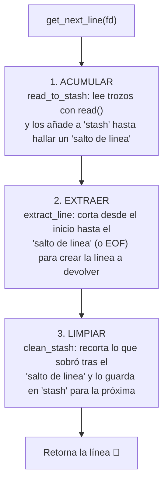

Markdown# 🛠️ Resumen Visual: Correcciones y Arquitectura de `get_next_line`
# FIXED GNL
---

## 🗺️ Flujo General de `get_next_line`



# Comparativa Gráfica: Antes vs. Después

## 1. Liberación destructiva en get_next_line 
- 💥❌ Antes:
```
stash = clean_stash(stash); ──► [guarda sobrante en memoria]
return (free(stash), line);  ──► 💥 ¡DESTRUYE el sobrante inmediatamente!
```
Efecto: En la siguiente llamada, stash apuntaba a basura (SIGSEGV).

- ✅ Después:
```
stash = clean_stash(stash); ──► [guarda sobrante intacto para la próxima]
return (line);               ──► Devuelve la línea de forma segura.
```

## 2. Inicialización de stash (Primera llamada) 
- 🚨❌ Antes:
```
stash = NULL;
stash = ft_strjoin(stash, buffer); 
            │
            └──► if (!s1 || !s2) return (NULL); ──► 💥 Devuelve NULL de golpe.
```
- ✅ Después:

```
if (!stash)
    stash = ft_strdup(""); ──► stash = "" (puntero válido de longitud 0)
stash = ft_strjoin(stash, buffer); ──► Concatena perfectamente.
```

## 3. Fuga de memoria acumulativa en el bucle de lectura 
- 🚰❌ Antes:
```
stash = ft_strjoin(stash, buffer);
```

[Bloque viejo] ──► 🗑️ Queda flotando en el limbo sin liberar (Memory Leak).
[Bloque nuevo] ◄── stash apunta aquí.

- ✅ Después:
```
tmp = stash;                       ──► Apunta al bloque anterior.
stash = ft_strjoin(tmp, buffer);   ──► Crea el nuevo bloque.
free(tmp);                         ──► 🧹 Libera el bloque viejo limpiamente.
```

## 4. Cuello de botella en read_to_stash (TIMEOUT con BUFFER_SIZE = 1) 

- ⏱️❌ Antes (Lento - O(N²)):
```
while (!ft_strchr(stash, '\n'))
```
¡Revisa TODO el stash acumulado en CADA vuelta!
Vuelta 1: 1 char
Vuelta 5.000: 5.000 chars
Vuelta 10.000: 10.000 chars (millones de lecturas ⏳)

- ✅ Después (Rápido - O(N)):
```
bytes_read = read(fd, buffer, BUFFER_SIZE);
if (ft_strchr(buffer, '\n')) ──► Solo revisa el buffer recién leído.
    break ;                  ──► Si BUFFER_SIZE=1, solo mira 1 byte ⚡.
```

## 📊 Resumen de Cambios por Función

| Función ⚙️ | Problema previo ⚠️ | Solución aplicada 🛠️ |
| :--- | :--- | :--- |
| **`get_next_line`** | `free(stash)` al retornar y `stash` empezaba en `NULL`. | Quitar el `free` final e inicializar con `ft_strdup("")`. |
| **`read_to_stash`** | Fuga en `ft_strjoin` y búsqueda lenta en `stash`. | Puntero temporal `tmp` para liberar y búsqueda rápida en `buffer`. |
| **`clean_stash`** | Se calculaba el tamaño con `len` total en vez de restante. | `ft_strlen(stash) - i` para recortar con exactitud. |