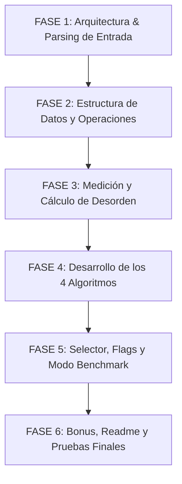
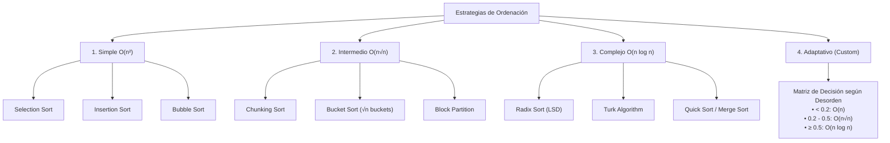
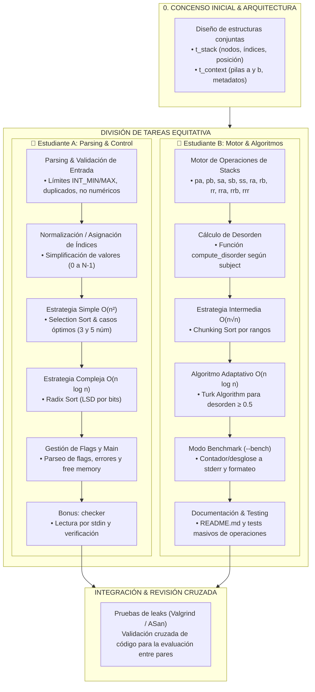

Nota sobre la marcha de lo que escucho:
- investigar, algoritmo turco, metodo simple de min max

github con explicaciones
kurro 

# pizarra 1

## 📌 Transcripción y Traducción de NotasPUSH-SWAP 
### (Pasos Generales)
1. Parseo (Parse): Llenar la pila a (stack a) con los valores de entrada.   
2. Push/Swap: Diferentes métodos para mover valores en las pilas a/b (sa, sb, ss, ...).   
    - Push: pa, pb   
    - Swap: sa, sb, ss   
    - Rotate: ra, rb, rr   
    - Reverse (Rotate): rra, rrb, rrr (en la pizarra indica la acción de invertir o rotar al revés).   
3. Algoritmos de ordenación (Sorting algos):
    - Simple, medio, complejo, personalizado (simple, medium, complex, custom).   
4. Desorden (Disorder): “¿Qué tan lejos está a de estar ordenada?”   

### Detalles de Parseo y Estructura de Datos
- Parseo (Parse):
     - Los valores no deben repetirse.   
     - Uso de ft_atoi(av[x]) $\rightarrow$ llenar la pila (fill stack).   
     - Banderas / pruebas de rendimiento (flags / bench).   
     - Estructura de la pila (stack structure):

```c
typedef struct s_stack
{
    int value;
    int index;
    int position;
} t_stack;
```

(Nota: También muestra conectar t_list->content = t_stack si usas listas enlazadas tipo t_list).   


## 🔍 Revisión Técnica 
- (¿Es correcto?)
- El esquema conceptual planteado en la pizarra es completamente correcto y acertado para afrontar el proyecto push_swap:
    - Parseo y validación: Es fundamental comprobar que no hay duplicados, que todos los argumentos son enteros dentro de los límites (INT_MAX / INT_MIN) y numéricos válidos.
    - Operaciones permitidas: Las listas de comandos descritas (pa, pb, sa, sb, ss, ra, rb, rr, rra, rrb, rrr) corresponden exactamente a la especificación del sujeto de 42. (Nota: en la pizarra de la sección de rotate/reverse faltaba una ligera distinción gráfica en las letras, pero la lógica de las 4 familias de comandos es idéntica a la oficial).
    - Estructura de datos (t_stack): Guardar el value (valor original), el index (índice simplificado/rank) y la position (posición actual en la pila) es la mejor práctica común en 42 para implementar algoritmos como Turco (Turk algorithm), Radix o K-Sort de forma eficiente.


# pizarra 2

## 📌 Transcripción de la PizarraPUSH_SWAP. 

1. Plantea las estructuras necesarias

```c
t_stack: int size   
int *head   
    t_stack *next   (...)   
    t_context:t_stack a   
t_stack b   (...)
```

2. Parser:
- Chequea que:
    - No haya duplicados.   $\text{INT\_MIN} \le n \le \text{INT\_MAX}$.   
    - Entradas inválidas: "abc", "+-42" ❌.   
    - Argumentos vacíos: "" ❌.   
    - Consideraciones que no estén en el subject.   
- Guarda las flags:
    - --simple, --medium, --complex, --adaptive y --bench.   
    - (Devuelve ERROR si lees 2 flags de estrategia).   

3. Movimientos y algoritmospa, 
- pb, ra, rb, ...   
- RECOMENDADO:
    - Simple: Selection Sort   
    - Medio: Chunking Sort   
    - Complejo: Radix Sort   

4. MAIN:
    1. Parseo   
    2. Construir el stack A   
    3. Leer flags   
    4. Seleccionar algoritmo   
    5. Imprimir los movimientos   
    6. (Benchmark, si hay flag --bench)   
    7. Libera el stack   
    
## CONSEJO 
!!!Haz el código pensando en meter una posible nueva flag.   

## 🔍 Revisión Técnica 
- (¿Es correcto?)
- El planteamiento de la pizarra es muy acertado y completo, especialmente si estás implementando una versión extendida de Push Swap (o con bonus/flags de evaluación):
1. Estructuras de datos:
    - Separar el contexto general (t_context) de los nodos o pilas (t_stack) facilita enormemente la gestión del estado general del programa y el paso de parámetros entre funciones.
2. Parseo y casuísticas bordes:
    - Comprobar la ausencia de duplicados, el rango de enteros INT_MAX / INT_MIN y rechazar entradas con signos erróneos ("+-42") o strings vacíos ("") cubre todos los casos de error estándar exigidos por el subject oficial de 42.
3. Estrategia de algoritmos:
    - La división por complejidad (Simple/Medio/Complejo) es la habitual:
        - Selection Sort / Insertion Sort: Para pocos elementos ($\le 5$).
        - Chunking / Turk Algorithm / Radix Sort: Estrategias clave para batches grandes (100 y 500 números) para mantenerse dentro del límite máximo de movimientos permitido.
4. Gestión de memoria:
    - El paso 7 del main (Libera el stack) es imprescindible en 42 para evitar memory leaks (comprobado rigurosamente con Valgrind o la flag -fsanitize=address).


# 📌 Resumen Esquematizado del Subject. 

1. Estructura General y Trabajo en Equipo
    - Modalidad: Proyecto en grupo de 2 personas. Ambos deben entender y explicar el 100% del código.   
    - Entregables: Repositorio Git con Makefile, archivos .c y .h, además del README.md obligatorio con autorías detalladas.   
2. Reglas del Programa y Operaciones Permitidas
     Tienes dos pilas o stacks (a y b). El objetivo es ordenar los números en a de forma ascendente usando el mínimo de operaciones posibles.   
    - Swap (sa, sb, ss): Intercambia los 2 primeros elementos del stack.   
    - Push (pa, pb): Pasa el primer elemento de un stack al otro.   
    - Rotate (ra, rb, rr): Mueve el elemento superior al fondo del stack.   
    - Reverse Rotate (rra, rrb, rrr): Mueve el elemento del fondo a la parte superior.   

3. Requisitos del Parsing y Flags de Ejecución
    - Validación: Comprobar que no existan duplicados, cadenas vacías (""), valores que no sean enteros o números fuera del rango INT_MIN a INT_MAX. 
    Retornar Error\n por stderr si falla algo.   
    - Flags de Selección de Algoritmo:
        - --simple $\rightarrow$ Fuerza algoritmo $O(n^2)$.   
        - --medium $\rightarrow$ Fuerza algoritmo $O(n\sqrt{n})$.   
        - --complex $\rightarrow$ Fuerza algoritmo $O(n \log n)$.   
        - --adaptive $\rightarrow$ Comportamiento por defecto (calcula el Índice de Desorden).   
    - Flag de Modo Benchmark (--bench): Muestra por stderr las métricas (porcentaje de desorden, estrategia usada, conteo total y desglose de operaciones).   

4. Las 4 Estrategias de Algoritmos Exigidas
    - Simple $O(n^2)$: Ej. Selection Sort, Bubble Sort o Insertion Sort adaptado a stacks.   
    - Intermedio $O(n\sqrt{n})$: Ej. Chunking Sort dividiendo el stack en $\sqrt{n}$ bloques/mallas.   
    - Complejo $O(n \log n)$: Ej. Radix Sort, Merge Sort o Quick Sort adaptado a stacks.   
    - Adaptativo (Por defecto): Calcula el índice de desorden antes de cualquier movimiento:   
        - Desorden $< 0.2$: Debe ejecutar en $O(n)$.   
        - Desorden $0.2 \le d < 0.5$: Debe ejecutar en $O(n\sqrt{n})$.   
        - Desorden $\ge 0.5$: Debe ejecutar en $O(n \log n)$.   

5. Umbrales de Rendimiento para la Evaluación
    - 100 números:
        - $< 2000$ ops (Aprobado justo)   
        - $< 1500$ ops (Bueno)   
        - $< 700$ ops (Excelente)  
    - 500 números:
        - $< 12000$ ops (Aprobado justo)   
        - $< 8000$ ops (Bueno)   
        - $< 5500$ ops (Excelente)   

6. Parte Bonus (checker)
    - Crear el binario checker que reciba el stack inicial como argumento.   
    - Lee las instrucciones emitidas por stdin y las ejecuta.   
    - Imprime OK\n si a queda ordenado y b vacío; si no, imprime KO\n.   
    
### 🔄 Esquema de Flujo de Trabajo (Fases del Proyecto)


## Detalle por Fases:
## - FASE 1: Parsing y Validación de Entradas
    - Diseñar la lectura de argc / argv.   
    - Crear funciones de verificación: detección de signos inválidos, no numéricos, límites de INT_MIN / INT_MAX y búsqueda de valores duplicados.   
    - Controlar la impresión adecuada de Error\n.   

## - FASE 2: Estructuras y Primitivas del Stack
- Definir la estructura t_stack (usualmente mediante listas doblemente enlazadas con índices/rangos simplificados):

(transcribir la funcion con while)
```c
function compute_disorder(stack a):
mistakes = 0
total_pairs = 0
for i from 0 to size(a)-1:
for j from i+1 to size(a)-1:
total_pairs += 1
if a[i] > a[j]:
mistakes += 1
return mistakes / total_pairs
```
- Programar de forma aislada las 11 instrucciones requeridas (sa, sb, pa, pb, ra, rb, rra, rrb, etc.) para asegurar que modifiquen el stack de forma impecable:

### 🔄 Operaciones Permitidas en Push_swap

#### 1. Swap (Intercambio)
* `sa` (**swap a**): Intercambia los dos primeros elementos en la cima del stack a[cite: 12]. No realiza ninguna acción si el stack tiene un elemento o está vacío[cite: 12].
* `sb` (**swap b**): Intercambia los dos primeros elementos en la cima del stack b[cite: 12]. No realiza ninguna acción si el stack tiene un elemento o está vacío[cite: 12].
* `ss`: Ejecuta `sa` y `sb` de forma simultánea[cite: 12].

#### 2. Push (Empujar / Transferir)
* `pa` (**push a**): Toma el primer elemento disponible en la cima del stack b y lo coloca en la cima del stack a[cite: 13]. No realiza ninguna acción si b está vacío[cite: 13].
* `pb` (**push b**): Toma el primer elemento disponible en la cima del stack a y lo coloca en la cima del stack b[cite: 13]. No realiza ninguna acción si a está vacío[cite: 13].

#### 3. Rotate (Rotación hacia arriba)
* `ra` (**rotate a**): Desplaza hacia arriba todos los elementos del stack a en una posición[cite: 13]. El elemento situado en la cima pasa a ser el último[cite: 13].
* `rb` (**rotate b**): Desplaza hacia arriba todos los elementos del stack b en una posición[cite: 13]. El elemento situado en la cima pasa a ser el último[cite: 13].
* `rr`: Ejecuta `ra` y `rb` de forma simultánea[cite: 13].

#### 4. Reverse Rotate (Rotación inversa hacia abajo)
* `rra` (**reverse rotate a**): Desplaza hacia abajo todos los elementos del stack a en una posición[cite: 13]. El elemento situado en el fondo pasa a ser la nueva cima[cite: 13].
* `rrb` (**reverse rotate b**): Desplaza hacia abajo todos los elementos del stack b en una posición[cite: 13]. El elemento situado en el fondo pasa a ser la nueva cima[cite: 13].
* `rrr`: Ejecuta `rra` y `rrb` de forma simultánea[cite: 13].   

## - FASE 3: Cálculo del Índice de Desorden
    - Implementar la función compute_disorder para evaluar el porcentaje de errores/inversiones en el orden del stack inicial.   

## - FASE 4: Algoritmos de Ordenación
    - Casos pequeños (2 a 5 elementos): Hardcodear casos óptimos muy rápidos (p. ej., ordenar 3 números en $\le 2$ movimientos).   
    - Algoritmo Simple ($O(n^2)$): Selection/Insertion sort para el flag --simple.   
    - Algoritmo Intermedio ($O(n\sqrt{n})$): Chunking sort.   
    - Algoritmo Complejo ($O(n \log n)$): Radix sort o Turk Algorithm optimizado.   
    - Algoritmo Adaptativo: Enrutador dinámico que llama a los métodos anteriores según el umbral de desorden calculado en la Fase 3.   

## - FASE 5: Modos Especiales (Flags & Benchmarks)
    - Parsear las opciones --simple, --medium, --complex y --adaptive.   
    - Implementar la flag opcional --bench para emitir el resumen de rendimiento por stderr.   

## - FASE 6: Bonus (checker), Pruebas y Documentación
    - Desarrollar el programa checker para leer comandos de stdin.   
    - Redactar el README.md obligatorio con autorías, justificaciones teóricas de algoritmos y descripciones de uso de IA.   
    - Realizar pruebas masivas para garantizar 0 fugas de memoria (leaks) y cumplir los márgenes de operaciones requeridos para 100 y 500 enteros.   


Para conseguir la puntuación de Rendimiento Excelente en todos los rangos (<700 operaciones para 100 números y  <5500 operaciones para 500 números), se deben elegir muy bien los algoritmos para cada una de las 4 estrategias exigidas por el subject.   

### 📊 Esquema General de Algoritmos Posibles


### 🔍 Análisis de Algoritmos por Categóría
1. Estrategia Simple: 
O(n 2)

    - Opción A: Selection Sort Adaptado

        Cómo funciona: Busca el elemento mínimo en la pila a, lo rota hasta la cima y lo pasa (pb) a la pila b. Al terminar, devuelve todo a a (pa).

        Rendimiento: Pobre para listas grandes ( >2000 ops en 100 números). Cumple solo el requisito teórico.   

        Dificultad de implementación: Muy Baja (1/5).

    - Opción B: Insertion Sort Adaptado

        Cómo funciona: Toma elementos de a a b manteniéndolos ordenados en b insertándolos en su posición correcta.

        Rendimiento: Algo mejor en casos parcialmente ordenados.

        Dificultad de implementación: Baja (2/5).

💡 Recomendación para el flag --simple: Selection Sort. Dado que se usará para probar la flag --simple, lo ideal es la menor complejidad de código posible.

2. Estrategia Intermedia: 
O(n n)

    - Opción A: Chunking Sort (Por Bloques / Rangos)

        Cómo funciona: Divide los valores normalizados (índices de 0 a N−1) en N bloques. Envía a b primero los elementos del bloque más pequeño, usando rb para colocar los mayores arriba y los menores abajo dentro de b. Luego se devuelven a a de forma óptima.

        Rendimiento: Muy Bueno (~600 ops para 100 números, ~5500 ops para 500 números).

        Dificultad de implementación: Media (3/5).

    - Opción B: Bucket Sort adaptado a Stacks

        Cómo funciona: Similar a Chunking, pero repartiendo en n intervalos rígidos.

        Rendimiento: Bueno, pero genera más operaciones extras en las fronteras entre buckets.

        Dificultad de implementación: Media-Alta (3.5/5).

💡 Recomendación para el flag --medium: Chunking Sort. Es la implementación estándar para cumplir O(n n), ofreciendo un excelente equilibrio entre número de operaciones y sencillez conceptual.   

3. Estrategia Compleja: 
O(nlogn)
    - Opción A: Radix Sort (LSD en base 2 o base 4)

        Cómo funciona: Analiza los bits de los números ordenados por índice. Pasa a b los números que tienen un 0 en el bit actual y mantiene en a los que tienen 1.

        Rendimiento: Regular/Aceptable (~1100 ops en 100 núm, ~6700 ops en 500 núm). Pasa el corte del subject, pero no llega al nivel Excelente.   

        Dificultad de implementación: Muy Baja (1.5/5).

    - Opción B: Turk Algorithm (Algoritmo del Turco / Push Cost Algorithm)

        Cómo funciona: Asigna un "coste de operaciones" a cada nodo de a para ser insertado en su posición correcta dentro de b (combinando rr, rrr, ra, rb, etc.). Envía siempre el nodo con menor coste acumulado.

        Rendimiento: EXCELENTE (~550-620 ops para 100 números; ~4800-5300 ops para 500 números).

        Dificultad de implementación: Media-Alta (4/5).

    - Opción C: Quick Sort / Merge Sort adaptado

        Cómo funciona: Particiona recursivamente las pilas usando pivotes.

        Rendimiento: Bueno, pero la sobrecoste de llamadas recursivas y manejo de sub-stacks en C complica mucho el código.

        Dificultad de implementación: Alta (4.5/5).

💡 Recomendación para el flag --complex: Turk Algorithm. Es el mejor candidato si el objetivo es alcanzar el rango Excelente en operaciones.   

4. Estrategia Adaptativa (Custom / Por Defecto)
   
El subject exige que la estrategia por defecto elija internamente el método según el índice de desorden:   

- Desorden  <0.2 (O(n) exigido):   

    Algoritmo: Adaptive Insertion / Linear Fix. Identifica los 1 o 2 elementos fuera de sitio mediante una pasada lineal y realiza los swaps/rotaciones mínimos necesarios.

    Rendimiento: Extremadamente bajo en movimientos (<2n operaciones).

- Desorden  0.2≤d<0.5 (O(n n) exigido):   

    Algoritmo: Chunking Sort configurado con tamaño de bloque óptimo (≈ n ).

- Desorden ≥0.5 (O(nlogn) exigido):   

    Algoritmo: Turk Algorithm (o Radix totalmente optimizado).

### Matriz de comparativa de algoritmos

| Algoritmo | Categoría Exigida | Rendimiento ops (100 / 500) | Calificación de Rendimiento | Dificultad | Puntuación Global (Balón de Oro) |
| :--- | :--- | :--- | :--- | :---: | :--- |
| **Selection Sort** | Simple $O(n^2)$ | $>2500$ / $>30000$ | Insuficiente (solo para flag) | 1 / 5 | ⭐⭐⭐ (Ideal para cumplir `--simple`) |
| **Radix Sort (Base 2)** | Complejo $O(n \log n)$ | $\approx 1100$ / $\approx 6800$ | Aprobado Justo / Bueno | 1.5 / 5 | ⭐⭐⭐ (Muy fácil pero no "Excelente") |
| **Chunking Sort** | Intermedio $O(n\sqrt{n})$ | $\approx 600$ / $\approx 5500$ | Excelente | 3 / 5 | ⭐⭐⭐⭐⭐ (Imprescindible) |
| **Turk Algorithm** | Complejo / Custom | $\approx 580$ / $\approx 5100$ | Excelente Top | 3.8 / 5 | ⭐⭐⭐⭐⭐ (El mejor para nota máxima) |
| **Quick/Merge Sort** | Complejo $O(n \log n)$ | $\approx 700$ / $\approx 6000$ | Bueno | 4.5 / 5 | ⭐⭐ (Demasiado complejo en C) |

### 🏆 Veredicto y Hoja de Ruta para Desarrollar
Para conseguir la nota máxima/excelente con la relación rendimiento/esfuerzo más óptima:

- Estrategia Simple (--simple): Implementa Selection Sort. Tardarás 1 hora en programarlo y cumple el requisito.   

- Estrategia Intermedia (--medium): Implementa Chunking Sort. Cubrirá el requisito de 
O(n n) con métricas en el límite de la excelencia.   


- Estrategia Compleja (--complex): Implementa el Turk Algorithm. Garantiza entrar holgadamente en el rango Excelente (<700 en 100 números y <5500 en 500 números).   

- Estrategia Adaptativa (--adaptive): Enruta según el índice de desorden:   

        <0.2→ Corrección lineal O(n^2)   

        0.2 a 0.5→ Chunking Sort (O(n n))   

        ≥0.5→ Turk Algorithm (O(n log n))   


# Profundizando en Algoritmos: ("elegidos")
### --simple: $\mathcal{O}(n^2)$ - Selection Sort:

El algoritmo Selection Sort (Ordenamiento por Selección) es la estrategia más directa e intuitiva de todas para cumplir con el requisito de O(n^2) del flag --simple.   
- 💡 ¿Qué hace? (La idea central)
En lugar de intentar trucos matemáticos complejos, hace exactamente lo que haría una persona sin experiencia: busca el número más pequeño de la pila A, lo sube a la cima, lo aparta a la pila B, y repite el proceso hasta vaciar A. Al final, devuelve todo a la pila B en orden perfecto
- ⚙️ ¿Cómo funciona? (Mecánica de Stacks)
Dado que no puedes acceder directamente a posiciones intermedias de un stack con índices tipo array (como a[i]), tienes que rotar la pila para traer el elemento deseado hasta la cima.   
    - Localizar: Recorres la pila A de arriba a abajo y anotas cuál es el número más pequeño y en qué posición está.   
    - Calcular la ruta más corta hacia la cima: 
        - Si el mínimo está en la mitad superior del stack, rotas hacia arriba usando ra.   
        - Si está en la mitad inferior, rotas hacia abajo usando rra. 
    - Enviar a B: Una vez que el mínimo está en la cima de A, ejecutas pb. En B, los números quedan almacenados de mayor a menor (o en el orden inverso en que fueron empujados).   
    - Repetir: Haces lo mismo hasta que en A no quede ningún elemento (o queden solo 2 o 3 para acelerar).   
    - Vaciar B de vuelta a A: Pasas secuencialmente todos los elementos de B a A mediante pa. 
    Como salieron en orden ordenado, A queda completamente ordenado de menor a mayor de forma ascendente.   

- Paso a paso con un ejemplo visual
    - Supongamos que el stack a tiene los valores: [4, 2, 5, 1, 3] (donde 4 es la cima).
        - Paso 1: Buscar y extraer el 1 
            
            Pila inicial: a = [4, 2, 5, 1, 3], b = []   
            El mínimo es 1 (está en la parte baja).
            
            Hacemos rra $\rightarrow$ a = [3, 4, 2, 5, 1]   
            Hacemos rra $\rightarrow$ a = [1, 3, 4, 2, 5] (¡el 1 ya está en la cima!)   
            Hacemos pb $\rightarrow$ a = [3, 4, 2, 5], b = [1]   
        
        - Paso 2: Buscar y extraer el 2 
            
            El mínimo ahora en a es 2.
            
            Hacemos ra $\rightarrow$ a = [4, 2, 5, 3]   
            Hacemos ra $\rightarrow$ a = [2, 5, 3, 4] (el 2 está en la cima)   
            Hacemos pb $\rightarrow$ a = [5, 3, 4], b = [2, 1]   
        
        - Paso 3: Buscar y extraer el 3
            
            El mínimo ahora es 3.
            
            Hacemos ra $\rightarrow$ a = [3, 4, 5]   
            Hacemos pb $\rightarrow$ a = [4, 5], b = [3, 2, 1]   
            
        - Paso 4: Buscar y extraer el 4
        
            El mínimo es 4 (ya está en la cima).
            
            Hacemos directamente pb $\rightarrow$ a = [5], b = [4, 3, 2, 1]   
            
        - Paso 5: Mover el último elemento (el 5)
        
            Hacemos pb $\rightarrow$ a = [], b = [5, 4, 3, 2, 1]   
            
        - Paso 6: Devolver todo a A
            
            Hacemos pa 5 veces consecutivas:   
            
            pa $\rightarrow$ pasa el 5   
            pa $\rightarrow$ pasa el 4   
            pa $\rightarrow$ pasa el 3   
            pa $\rightarrow$ pasa el 2   
            pa $\rightarrow$ pasa el 1   
            Resultado final: a = [1, 2, 3, 4, 5] ordenado ascendentemente y b = [].   
            
    ⚖️ Pros y Contras en Push_swap
        
    Ventajas:Es el más fácil y rápido de programar de todo el proyecto (se hace con unas 30 líneas de código).Es conceptualmente infalible (siempre termina ordenando bien).Cumple a la perfección el requisito de algoritmo $\mathcal{O}(n^2)$ para la bandera --simple.   
        
    Desventajas:Consume una cantidad enorme de operaciones en pilas grandes (para 100 números puede llegar a superar las 2500 operaciones), por lo que no sirve para obtener la puntuación de rendimiento excelente en la parte general, utilizándose exclusivamente cuando se fuerza la bandera --simple.


## Reparto de carga



| Fase / Componente | Estudiante A (Parsing & Control) | Estudiante B (Motor & Algoritmos) | Carga Relativa |
| :--- | :--- | :--- | :---: |
| **0. Arquitectura** *(Conjunto)* | Diseño del nodo `t_stack` (valor, índice, posición)[cite: 1, 2] | Diseño de `t_context` (pila a, pila b, contadores)[cite: 2] | Equitativa |
| **1. Parseo y Primitivas** | **Parsing completo:** Lectura de argumentos, límites (`INT_MIN`/`INT_MAX`), rechazo de cadenas vacías/duplicados y salida `Error\n`[cite: 2, 18, 19] | **Motor de primitivas:** Funciones de los stacks con salida formateada (`sa`, `sb`, `pa`, `pb`, `ra`, `rb`, `rra`, `rrb`, etc.)[cite: 1, 13] | Equitativa |
| **2. Normalización y Métrica** | **Indexación / Normalización:** Función que asigna a cada elemento un índice de 0 a N-1[cite: 1] | **Cálculo de desorden:** Implementación de `compute_disorder` siguiendo la fórmula del subject[cite: 14] | Equitativa |
| **3. Algoritmos Iniciales** | **Estrategia Simple (O(n²)):** Selection Sort para `--simple` y algoritmos óptimos para 3 y 5 elementos[cite: 2, 15, 18] | **Estrategia Intermedia (O(n√n)):** Chunking Sort por rangos para `--medium`[cite: 2, 15, 18] | Equitativa |
| **4. Algoritmos Avanzados** | **Estrategia Compleja (O(n log n)):** Radix Sort por bits para cubrir `--complex` de forma directa[cite: 2, 15, 18] | **Algoritmo Adaptativo:** Motor Turk Algorithm para alcanzar rango Excelente cuando el desorden es ≥ 0.5[cite: 2, 15, 22] | Equitativa |
| **5. Main, Flags y Bench** | **Main y Selector de Flags:** Parseo de argumentos de configuración, validación de incompatibilidades y liberación de memoria[cite: 2, 18] | **Modo Benchmark (`--bench`):** Desglose y recuento de movimientos por tipo a `stderr` con formato de métricas[cite: 2, 19] | Equitativa |
| **6. Bonus y Cierre** | **Bonus (`checker`):** Lectura por `stdin` y validación de ordenación (`OK` / `KO`)[cite: 25] | **Documentación y Batería de Tests:** Redacción del `README.md` (justificaciones teóricas, IA)[cite: 20, 23, 27] y scripts de prueba para 100/500 números[cite: 22] | Equitativa |


